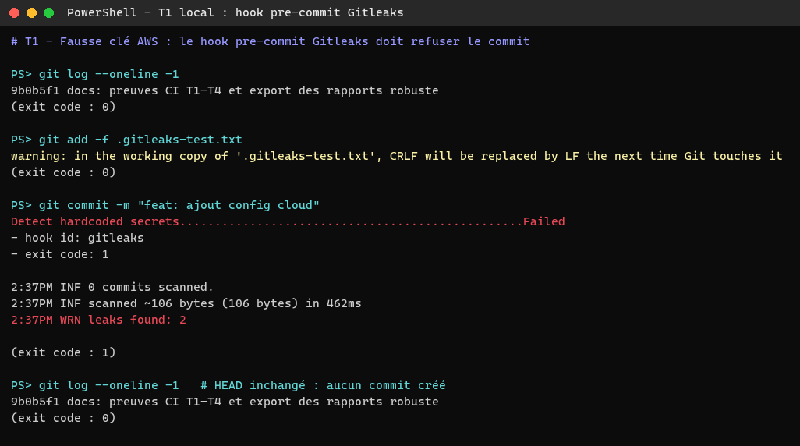
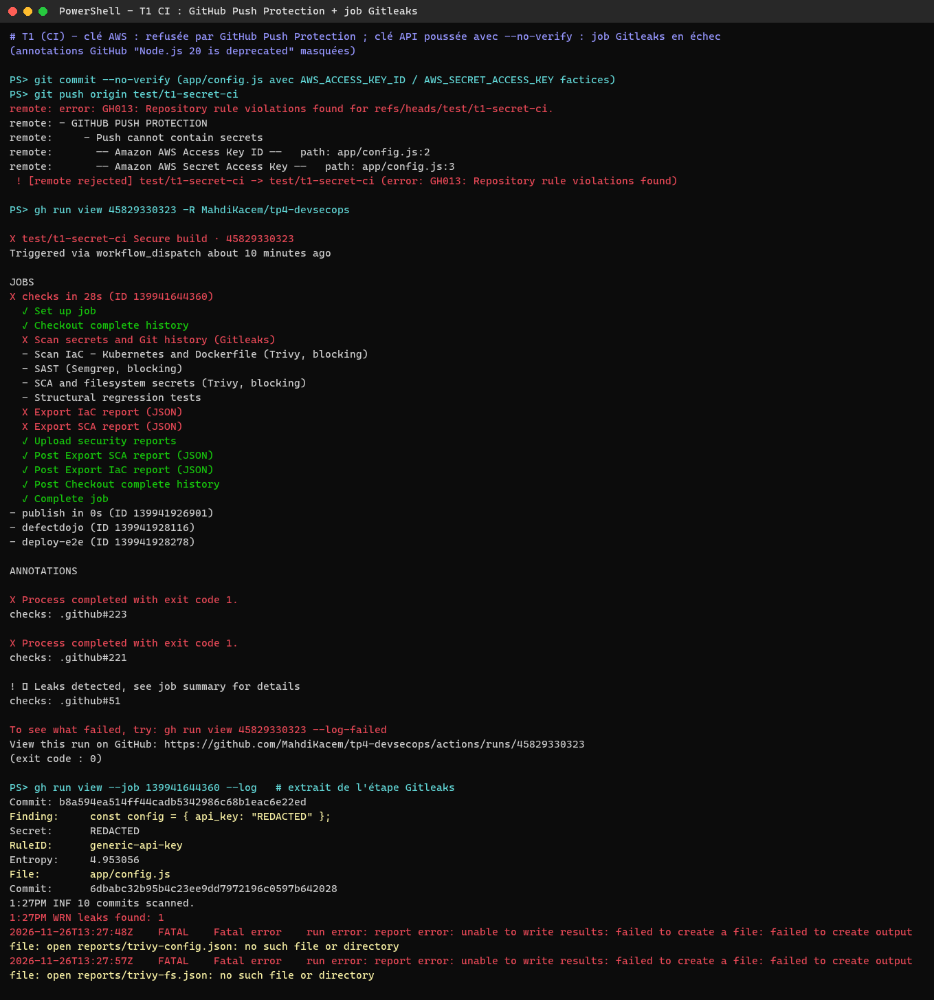
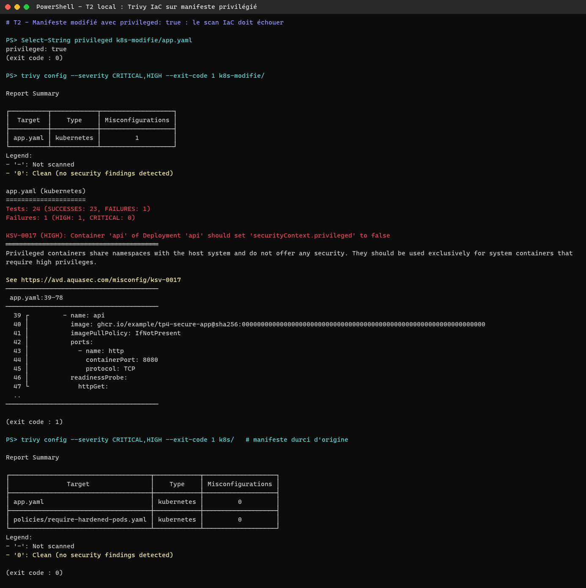
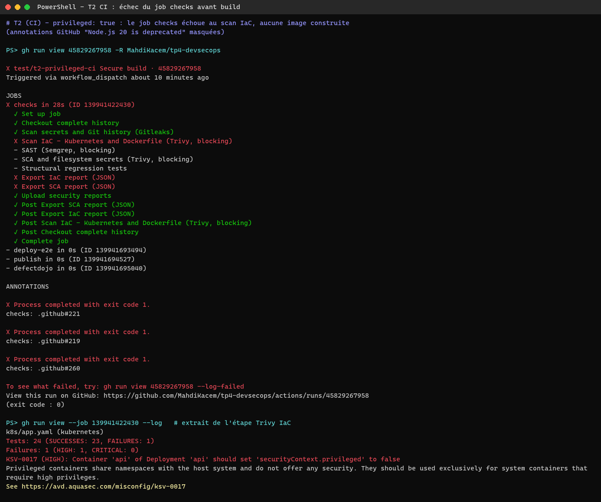
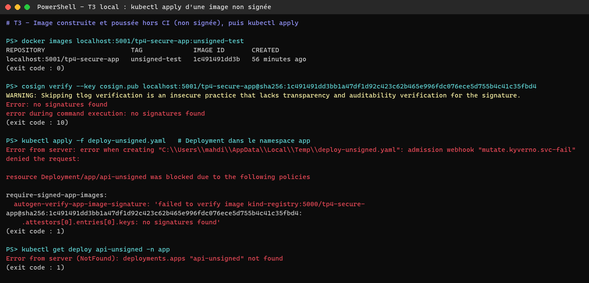
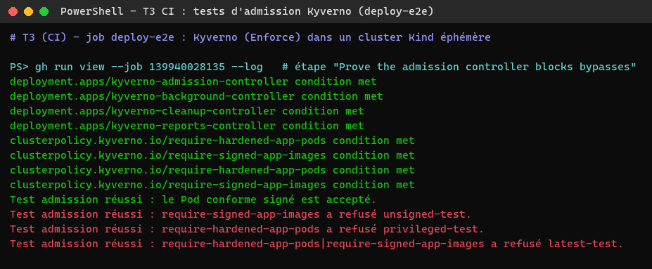
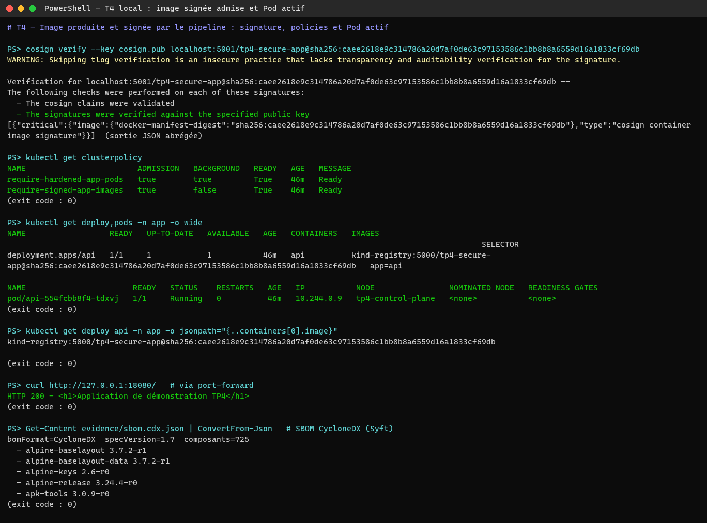
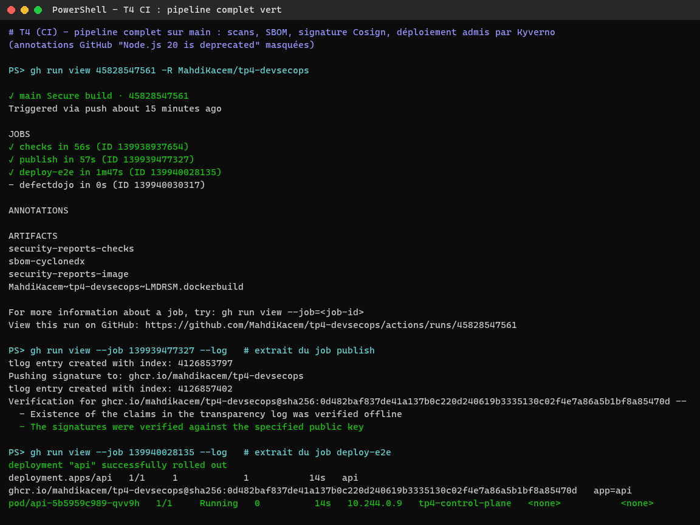

# Preuves d'exécution — scénarios T1 à T4

Chaque scénario a été exécuté deux fois : **en local** (poste Windows, cluster Kind `tp4` + Kyverno 1.16, registre local) et **en CI** (GitHub Actions, dépôt [MahdiKacem/tp4-devsecops](https://github.com/MahdiKacem/tp4-devsecops), image publiée sur GHCR).

À propos des captures : les images de `evidence/screenshots/` sont produites par `scripts/render-terminal.py` à partir de la sortie réelle des commandes. La sortie brute correspondante (`.txt`) est à côté de chaque image ; seuls les codes couleur ANSI et les avertissements GitHub « Node.js 20 is deprecated » ont été retirés. Les journaux complets des jobs CI sont dans `evidence/ci/`.

| Test | Contrôle sollicité | Résultat attendu | Résultat obtenu |
|---|---|---|---|
| T1 | Hook pre-commit / Gitleaks CI | Rejet du commit ou échec CI | ✅ Commit refusé en local ; push refusé par GitHub ; job Gitleaks en échec |
| T2 | Trivy IaC en CI | Échec avant toute construction d'image | ✅ `KSV-0017 (HIGH)`, `publish` jamais exécuté |
| T3 | Admission Kyverno | Blocage par l'API Kubernetes | ✅ `no signatures found`, Deployment non créé |
| T4 | CI complète + Cosign + Kyverno | Déploiement autorisé, SBOM, Pod actif | ✅ Pipeline vert, SBOM attestée, Pod `1/1 Running` |

---

## T1 — Commit d'une fausse clé d'accès cloud

**Action** : une fausse clé AWS (générée aléatoirement) est ajoutée dans un fichier puis commitée.

**Local** : le hook pre-commit `gitleaks protect --staged` détecte 2 fuites et fait échouer le commit ; `git log` montre que HEAD n'a pas bougé.

**CI** : pour simuler un développeur qui contourne le hook (`git commit --no-verify`) :

1. avec la clé AWS, le push est **refusé par GitHub Push Protection** (`GH013`) avant même que la CI démarre ;
2. avec une clé d'API générique (non reconnue par GitHub), le push passe mais le job `checks` échoue dès l'étape Gitleaks, qui analyse tout l'historique (`RuleID: generic-api-key`, `app/config.js`) ; aucune étape suivante n'est exécutée (run [45829330323](https://github.com/MahdiKacem/tp4-devsecops/actions/runs/45829330323)).

Journaux : `evidence/T1-precommit-gitleaks.log`, `evidence/T1-github-push-protection.log`, `evidence/ci/T1-ci-gitleaks-checks.log`. La branche de test a été supprimée.

---

## T2 — Manifeste Kubernetes avec `privileged: true`

**Local** : Trivy (`--severity CRITICAL,HIGH --exit-code 1`) sort en code 1 sur la variante privilégiée (`KSV-0017 (HIGH)`) et en code 0 sur le manifeste durci du dépôt.

**CI** : sur une branche où `k8s/app.yaml` contient `privileged: true`, le job `checks` échoue à l'étape « Scan IaC » ; les jobs `publish` et `deploy-e2e` sont **sautés** : aucune image n'est construite (run [45829267958](https://github.com/MahdiKacem/tp4-devsecops/actions/runs/45829267958)).

Journaux : `evidence/T2-test-static.log`, `evidence/ci/T2-ci-trivy-iac-checks.log`.

---

## T3 — Image construite localement, poussée, puis `kubectl apply`

**Local** : une image est construite et poussée dans le registre **sans passer par la CI** (donc non signée). `cosign verify` ne trouve aucune signature ; le `kubectl apply` d'un Deployment l'utilisant est **refusé par le webhook Kyverno** (`require-signed-app-images … no signatures found`) et le Deployment n'existe pas.

Tests d'admission complémentaires (local et CI, job `deploy-e2e`) : Pod signé et conforme **accepté** ; Pod non signé, Pod privilégié, image en `:latest` et image d'un registre tiers **refusés**.

Journaux : `evidence/T3-kubectl-unsigned.log`, `evidence/T3-admission-tests.log`, `evidence/T3-unsigned-build.log`, `evidence/ci/T4-ci-deploy-e2e.log`.

---

## T4 — Pipeline complet sur du code sain

**Local** (`scripts/local-pipeline.ps1` puis `scripts/deploy.ps1`) : scan d'image 0 HIGH/CRITICAL, SBOM CycloneDX (725 composants) générée et attestée, signature vérifiée avec `cosign.pub`, policies Kyverno `Ready`, Deployment `1/1`, Pod `Running`, application en HTTP 200.

**CI** (run [45828547561](https://github.com/MahdiKacem/tp4-devsecops/actions/runs/45828547561)) : `checks` → `publish` → `deploy-e2e` tous verts. L'image `ghcr.io/mahdikacem/tp4-devsecops@sha256:0d482baf…` est signée (entrée Rekor n° 4126853797), sa SBOM attestée (n° 4126857402), la signature est vérifiée, puis déployée dans un cluster Kind éphémère protégé par Kyverno : rollout réussi et Pod `1/1 Running`. L'artefact `sbom-cyclonedx` est conservé (`evidence/ci/sbom.cdx.json`).

Journaux : `evidence/T4-local-pipeline.log`, `evidence/T4-deploy.log`, `evidence/T4-verification.log`, `evidence/ci/T4-ci-checks.log`, `evidence/ci/T4-ci-publish.log`, `evidence/ci/T4-ci-deploy-e2e.log`.
