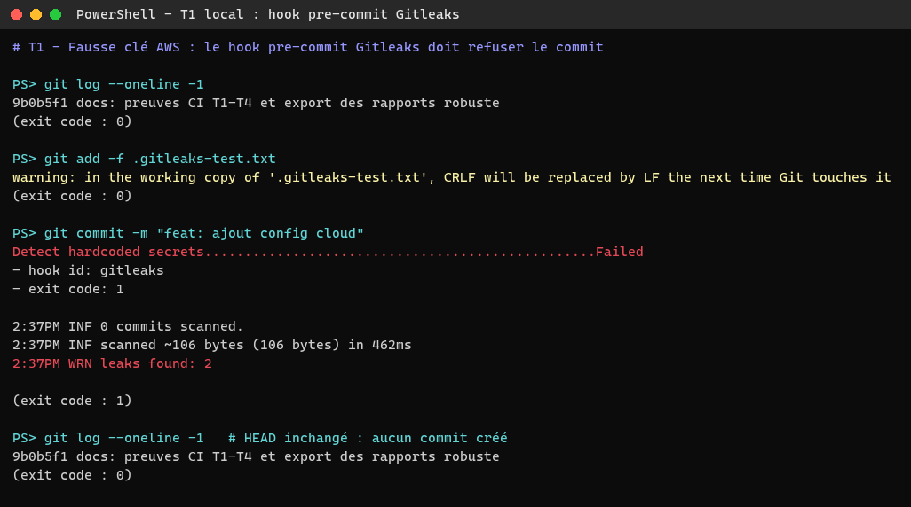
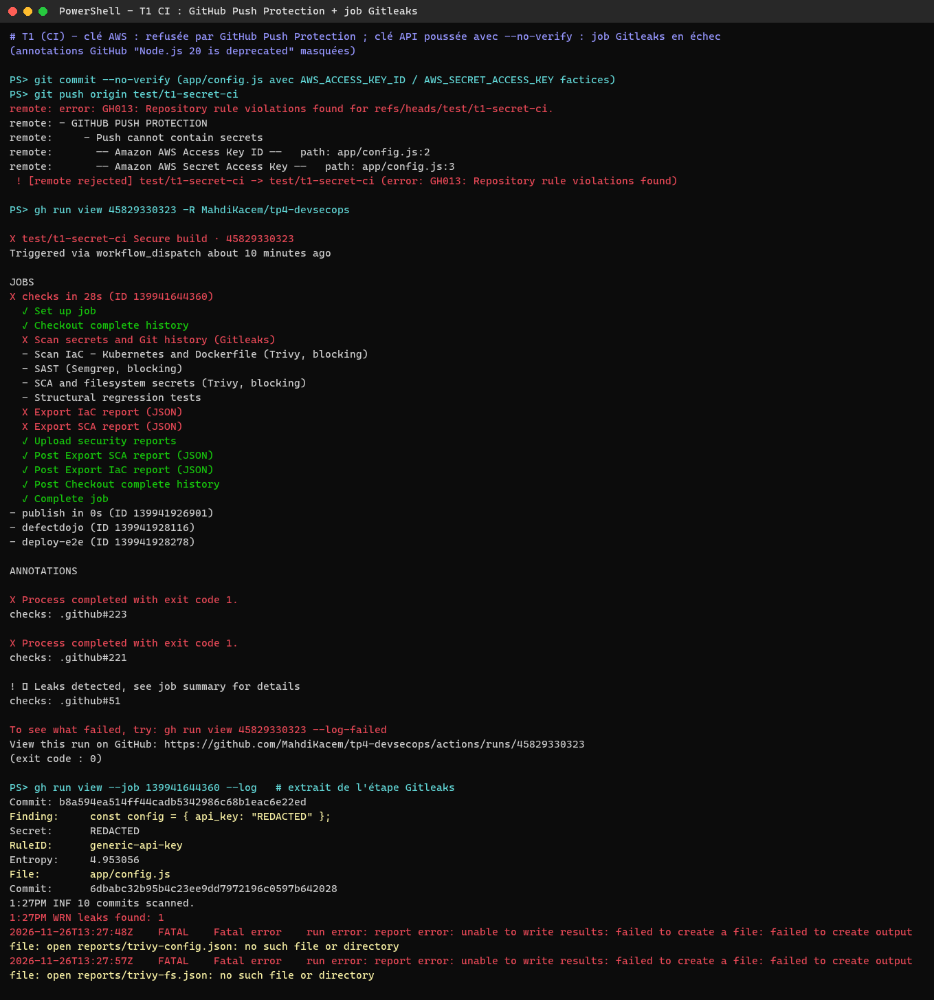
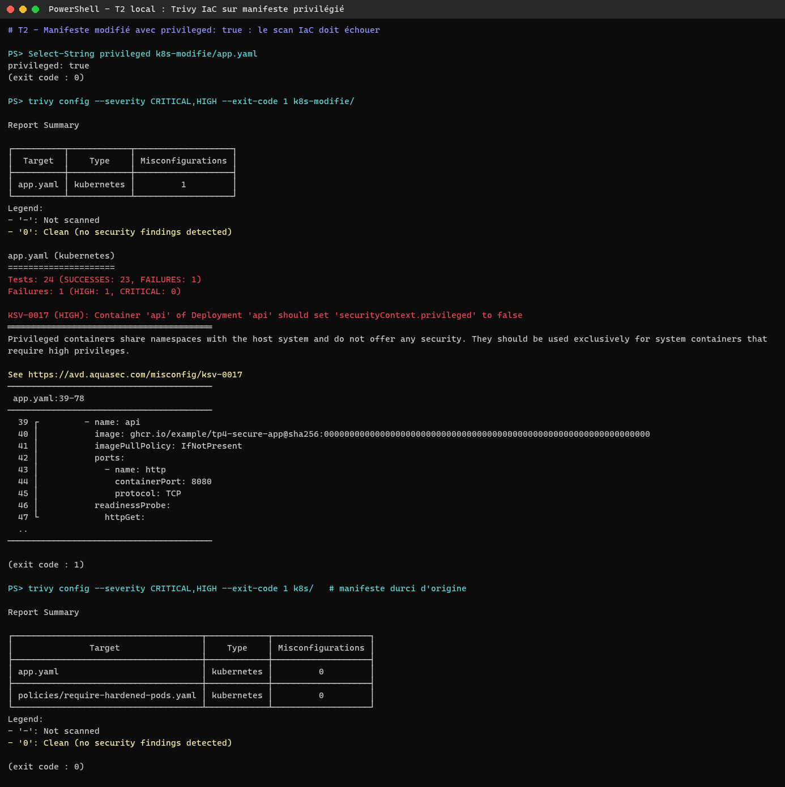
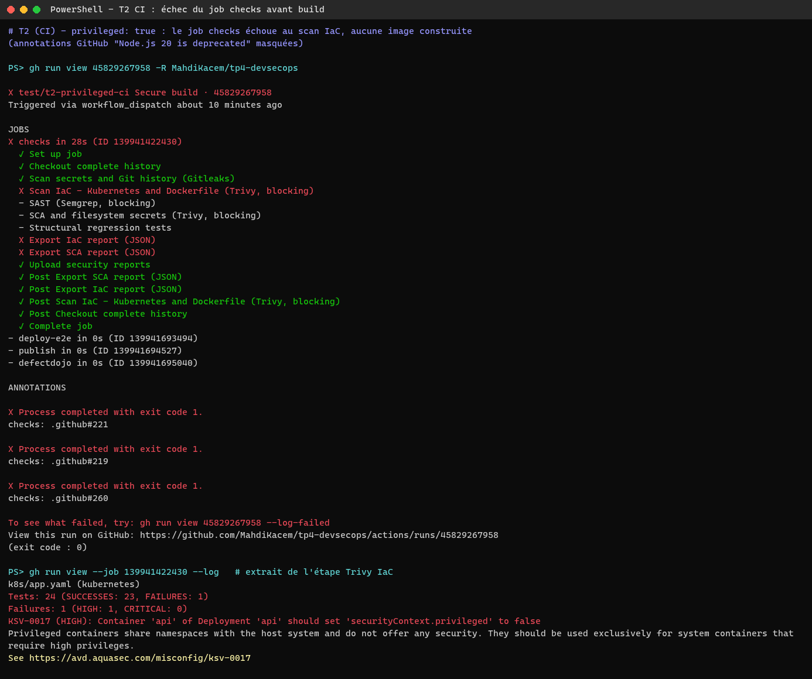
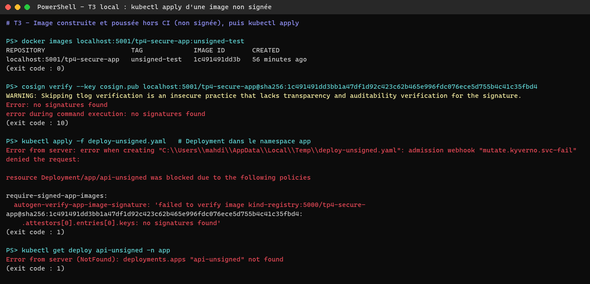
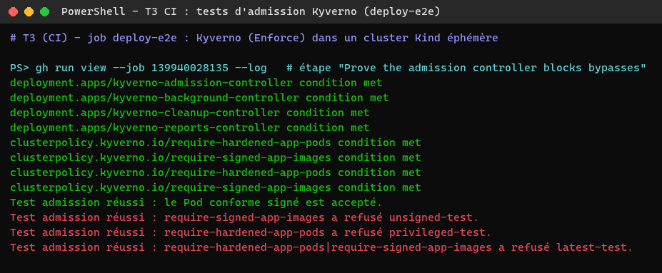
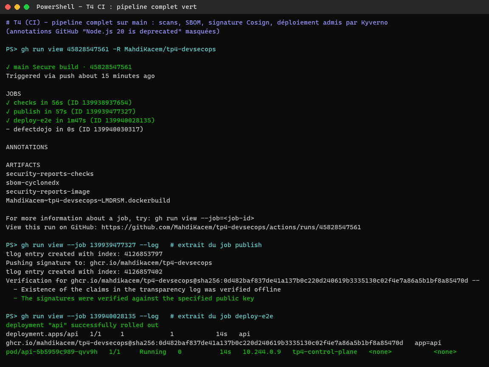
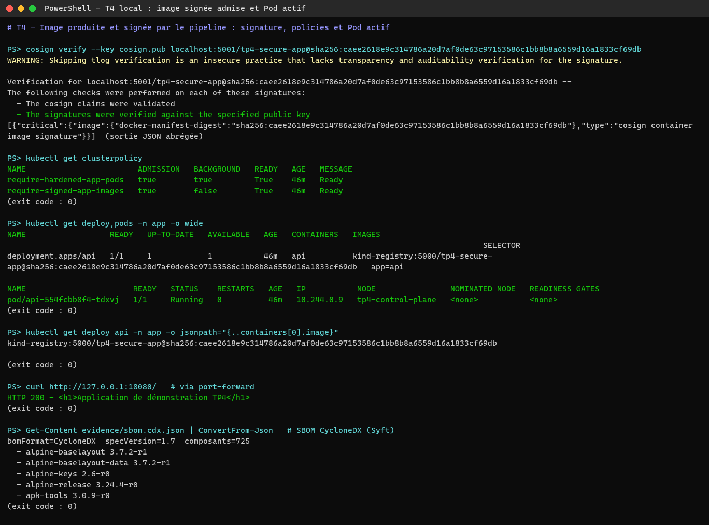
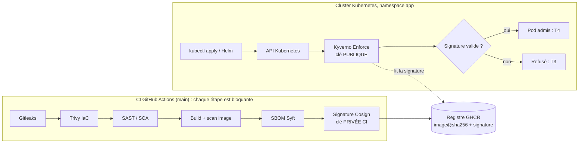

# Compte rendu — TP4 DevSecOps : Supply chain et Policy-as-Code

**Date** : 26/11/2026 · **Dépôt** : [github.com/MahdiKacem/tp4-devsecops](https://github.com/MahdiKacem/tp4-devsecops)

## Sommaire

1. [Introduction](#1-introduction)
2. [Environnement et outils](#2-environnement-et-outils)
3. [Étape 1 : verrouillage des secrets](#3-étape-1--verrouillage-des-secrets)
4. [Étape 2 : sécurisation de l'IaC](#4-étape-2--sécurisation-de-liac)
5. [Étape 3 : SBOM et signature cryptographique](#5-étape-3--sbom-et-signature-cryptographique)
6. [Étape 4 : gouvernance au déploiement avec Kyverno](#6-étape-4--gouvernance-au-déploiement-avec-kyverno)
7. [Étape 5 (bonus) : agrégation DefectDojo](#7-étape-5-bonus--agrégation-defectdojo)
8. [Scénarios de validation T1 à T4](#8-scénarios-de-validation-t1-à-t4)
9. [Problèmes rencontrés et solutions](#9-problèmes-rencontrés-et-solutions)
10. [Synthèse technique](#10-synthèse-technique)
11. [Conclusion et limites](#11-conclusion-et-limites)

---

## 1. Introduction

Le pipeline mis en place garantit qu'aucune image ne peut s'exécuter sur le cluster Kubernetes sans avoir été analysée et signée par la CI. Les quatre scénarios de validation (T1 à T4) ont été exécutés et réussis, en local et sur GitHub Actions.

**Contexte.** L'application (front web conteneurisé) disposait déjà de SAST, SCA, DAST, d'un scan d'image et d'une protection RASP. Un audit a révélé deux failles :

1. un développeur pouvait déployer manuellement une image non vérifiée directement sur le cluster ;
2. l'infrastructure exposait des configurations trop permissives (root, mode privilégié, tag `:latest`, aucun cloisonnement réseau) et des secrets en clair.

**Objectif.** Construire une chaîne de livraison Zero-Trust : détection des secrets, audit IaC bloquant, SBOM et signature cryptographique de l'image, puis contrôle d'admission Kyverno en mode Enforce qui refuse toute image non signée par la CI.

| Domaine | Outils utilisés | Rôle |
| --- | --- | --- |
| Gestion des secrets | Gitleaks, SOPS + Age | Blocage avant commit et en CI, chiffrement des secrets applicatifs |
| Sécurité IaC | Trivy config | Audit des manifestes Kubernetes et du Dockerfile, échec si HIGH/CRITICAL |
| SAST / SCA | Semgrep, Trivy fs | Analyse du code et des dépendances |
| Supply chain | Syft, Cosign | SBOM CycloneDX, signature et attestation de l'image |
| Policy-as-Code | Kind, Kyverno 1.16 | Admission bloquante : signature + durcissement des Pods |
| Gouvernance (bonus) | DefectDojo | Centralisation des rapports via `/api/v2/import-scan/` |

## 2. Environnement et outils

Tout a été exécuté sous Windows 11 avec PowerShell 7 et Docker Desktop, puis rejoué sur les runners Ubuntu de GitHub Actions.

| Outil | Version | Usage |
| --- | --- | --- |
| Gitleaks | 8.30.1 | Hook pre-commit + action CI (historique complet) |
| Trivy | 0.76.2 (local) | Scan IaC, SCA, image |
| Semgrep | 1.186.0 (image épinglée par digest) | SAST |
| Syft | 1.57.2 | SBOM CycloneDX |
| Cosign | 3.1.5 en local, 2.6.5 en CI | Signature et attestation |
| SOPS / Age | 3.13.3 | Chiffrement des secrets |
| Kind | 0.31.0, nœud Kubernetes 1.33.1 | Cluster local `tp4` |
| Helm / Kyverno | 4.3.1 / chart 3.6.4 (Kyverno 1.16.4) | Moteur de politiques |
| kubectl | 1.36.1 | Pilotage du cluster |

**Arborescence du dépôt :**

```text
.github/workflows/secure-build.yml   pipeline CI/CD (checks → publish → deploy-e2e → defectdojo)
.github/dependabot.yml               mises à jour des actions et de l'image de base
.pre-commit-config.yaml              hook Gitleaks
.sops.yaml  secrets/app.enc.yaml     secrets chiffrés SOPS/Age
Dockerfile  app/                     application nginx non-root
k8s/app.yaml                         manifestes durcis + NetworkPolicy
k8s/policies/require-hardened-pods.yaml
templates/verify-signed-images.yaml.in   policy de signature (rendue avec cosign.pub)
cosign.pub                           clé publique de confiance
scripts/   setup-kind, local-pipeline, apply-policies, deploy, import-defectdojo, render-terminal
tests/     test-static.ps1, test-admission.ps1
evidence/  journaux, captures et SBOM
```

Les clés privées ne sont jamais dans le dépôt : la clé Age est dans `~/.config/sops/age/keys.txt`, la clé Cosign dans `~/.cosign/tp4/` et dans les secrets GitHub `COSIGN_PRIVATE_KEY` et `COSIGN_PASSWORD`.

## 3. Étape 1 : verrouillage des secrets

Aucun secret ne peut entrer dans le dépôt : Gitleaks le bloque avant le commit puis en CI sur tout l'historique, et les secrets applicatifs sont chiffrés avec SOPS.

### 3.1 Hook pre-commit Gitleaks

Fichier `.pre-commit-config.yaml` :

```yaml
repos:
  - repo: local
    hooks:
      - id: gitleaks
        name: Detect hardcoded secrets
        entry: gitleaks protect --staged --redact --no-banner
        language: system
        pass_filenames: false
        always_run: true
```

Installation :

```powershell
python -m pip install --user pre-commit
python -m pre_commit install
```

### 3.2 Étape bloquante en CI

Premier contrôle du job `checks` dans `.github/workflows/secure-build.yml`. `fetch-depth: 0` récupère tout l'historique Git pour l'analyser.

```yaml
- name: Checkout complete history
  uses: actions/checkout@11d5960a326750d5838078e36cf38b85af677262 # v4.4.0
  with:
    fetch-depth: 0
    persist-credentials: false

- name: Scan secrets and Git history (Gitleaks)
  uses: gitleaks/gitleaks-action@ff98106e4c7b2bc287b24eaf42907196329070c7 # v2.3.9
  env:
    GITHUB_TOKEN: ${{ secrets.GITHUB_TOKEN }}
```

### 3.3 Externalisation des secrets avec SOPS et Age

La clé Age est générée hors du dépôt par `scripts/new-age-key.ps1`, qui écrit le destinataire public dans `.sops.yaml` :

```yaml
creation_rules:
  # Accepte les séparateurs / et \ (SOPS compare le chemin absolu, y compris sous Windows).
  - path_regex: (^|[/\\])secrets[/\\][^/\\]+\.enc\.yaml$
    age: age14r5j77r7pgydkv4ey3tmts9qtg6jca70lncxercw8jrehvxmecnsvn8n4l
```

Chiffrement et vérification :

```powershell
sops --encrypt --filename-override secrets/app.enc.yaml --output secrets/app.enc.yaml secrets/app.yaml
$env:SOPS_AGE_KEY_FILE = "$env:USERPROFILE\.config\sops\age\keys.txt"
sops --decrypt secrets/app.enc.yaml
```

Sortie (fichier versionné `secrets/app.enc.yaml`, valeurs chiffrées) :

```text
encrypt exit=0
API_KEY: ENC[AES256_GCM,data:b8x1A4TXEFppnsYrHcQRndLqk0p5ZvIiHp1ESw9Tx/jKtC2BXQpmxg==,iv:gqIS...,type:str]
SESSION_SECRET: ENC[AES256_GCM,data:/xFNS26+N0MWd79yXJ1+EmbDQWYIB1UZrDI5Cqz7TDLrWmUq...,type:str]
DB_PASSWORD: ENC[AES256_GCM,data:zkBKJSZA6bzZoXlIktazEvUVjBNrynNEo2D0UvGj18w=,...,type:str]
sops:
decrypt exit=0, keys: API_KEY,SESSION_SECRET,DB_PASSWORD
1:16PM INF no leaks found      # gitleaks sur le fichier chiffré
```

Le fichier en clair `secrets/app.yaml` est exclu par `.gitignore` (`secrets/*.yaml`, `!secrets/*.enc.yaml`). Un fichier parasite nommé `GITHUB_TOKEN=ghp_…`, reste d'un premier essai, a été supprimé avant tout commit ; le jeton était factice, il n'y avait donc rien à révoquer.

## 4. Étape 2 : sécurisation de l'IaC

Les manifestes durcis passent Trivy sans aucune anomalie, et toute régression HIGH ou CRITICAL (par exemple `privileged: true`) fait échouer le pipeline avant la construction de l'image.

### 4.1 Scan IaC bloquant en CI

```yaml
- name: Scan IaC - Kubernetes and Dockerfile (Trivy, blocking)
  uses: aquasecurity/trivy-action@ed142fd0673e97e23eac54620cfb913e5ce36c25 # v0.36.0
  with:
    scan-type: config
    scan-ref: .
    severity: CRITICAL,HIGH
    exit-code: "1"
```

### 4.2 Workload durci (`k8s/app.yaml`, extrait)

```yaml
spec:
  serviceAccountName: api
  automountServiceAccountToken: false
  securityContext:
    runAsNonRoot: true
    runAsUser: 101
    runAsGroup: 101
    seccompProfile:
      type: RuntimeDefault
  containers:
    - name: api
      image: ghcr.io/example/tp4-secure-app@sha256:<digest>   # digest immuable, jamais :latest
      securityContext:
        privileged: false
        allowPrivilegeEscalation: false
        readOnlyRootFilesystem: true
        capabilities:
          drop:
            - ALL
      resources:
        requests: { cpu: 50m, memory: 32Mi }
        limits:   { cpu: 250m, memory: 128Mi }
      volumeMounts:            # seuls répertoires inscriptibles
        - { name: nginx-cache, mountPath: /var/cache/nginx }
        - { name: nginx-run,   mountPath: /var/run }
        - { name: tmp,         mountPath: /tmp }
```

Le digest d'exemple est remplacé au déploiement par celui que produit le pipeline (`scripts/deploy.ps1`).

### 4.3 Cloisonnement réseau

```yaml
apiVersion: networking.k8s.io/v1
kind: NetworkPolicy
metadata:
  name: api-restrict-traffic
  namespace: app
spec:
  podSelector:
    matchLabels: { app: api }
  policyTypes: [Ingress, Egress]
  ingress:
    - from:
        - namespaceSelector:
            matchLabels: { kubernetes.io/metadata.name: ingress-nginx }
      ports: [{ protocol: TCP, port: 8080 }]
  egress:                        # DNS uniquement
    - to:
        - namespaceSelector:
            matchLabels: { kubernetes.io/metadata.name: kube-system }
          podSelector:
            matchLabels: { k8s-app: kube-dns }
      ports: [{ protocol: UDP, port: 53 }, { protocol: TCP, port: 53 }]
```

### 4.4 Sortie du scan sur le dépôt

```text
PS> trivy config --severity CRITICAL,HIGH --exit-code 1 .
┌─────────────────────────────────────────┬────────────┬───────────────────┐
│                 Target                  │    Type    │ Misconfigurations │
├─────────────────────────────────────────┼────────────┼───────────────────┤
│ Dockerfile                              │ dockerfile │         0         │
│ k8s/app.yaml                            │ kubernetes │         0         │
│ k8s/policies/require-hardened-pods.yaml │ kubernetes │         0         │
└─────────────────────────────────────────┴────────────┴───────────────────┘
trivy exit=0
```

Les tests structurels (`tests/test-static.ps1`) vérifient aussi la présence de chaque réglage, de la NetworkPolicy, de l'image par digest et l'absence de `:latest`. Ils vérifient enfin que toutes les actions GitHub sont épinglées par SHA de commit.

## 5. Étape 3 : SBOM et signature cryptographique

L'image n'est signée qu'après avoir passé tous les contrôles. La signature porte sur son digest SHA-256, et la SBOM CycloneDX lui est attachée par une attestation Cosign.

### 5.1 Image de base

Le premier scan d'image a bloqué la signature : l'image `nginx-unprivileged:stable-alpine` épinglée au départ portait 5 CVE CRITICAL et 15 HIGH, toutes corrigées en amont. Nouveau `Dockerfile` :

```dockerfile
FROM nginxinc/nginx-unprivileged:mainline-alpine-slim@sha256:a8cb0f33d51fa107c96fd2bd3a71aaf564ec131e9d2bdf8700944f0ed8b170d7
USER root
RUN apk upgrade --no-cache          # correctifs Alpine publiés après l'image amont
COPY --chown=101:101 app/ /usr/share/nginx/html/
USER 101:101
EXPOSE 8080
```

### 5.2 Paire de clés Cosign

```powershell
cosign generate-key-pair          # dans ~/.cosign/tp4, hors du dépôt
Get-Content -Raw ~/.cosign/tp4/cosign.key   | gh secret set COSIGN_PRIVATE_KEY -R MahdiKacem/tp4-devsecops
Get-Content -Raw ~/.cosign/tp4/password.txt | gh secret set COSIGN_PASSWORD    -R MahdiKacem/tp4-devsecops
```

Seule la clé publique `cosign.pub` est versionnée.

### 5.3 Job `publish` (uniquement sur `main`, après `checks`)

```yaml
- name: Build and push immutable commit tag
  id: build
  uses: docker/build-push-action@10e90e3645eae34f1e60eeb005ba3a3d33f178e8 # v6.19.2
  with:
    context: .
    pull: true
    push: true
    provenance: false
    tags: ${{ env.IMAGE }}:${{ github.sha }}

- name: Scan pushed image (Trivy, blocking)
  uses: aquasecurity/trivy-action@ed142fd0673e97e23eac54620cfb913e5ce36c25 # v0.36.0
  with:
    image-ref: ${{ steps.ref.outputs.image }}
    severity: CRITICAL,HIGH
    exit-code: "1"

- name: Generate CycloneDX SBOM
  run: syft "${{ steps.ref.outputs.image }}" -o cyclonedx-json=sbom.cdx.json

- name: Install Cosign
  uses: sigstore/cosign-installer@7e8b541eb2e61bf99390e1afd4be13a184e9ebc5 # v3.10.1
  with:
    cosign-release: v2.6.5

- name: Sign image digest and attest its SBOM
  env:
    COSIGN_PRIVATE_KEY: ${{ secrets.COSIGN_PRIVATE_KEY }}
    COSIGN_PASSWORD: ${{ secrets.COSIGN_PASSWORD }}
    IMAGE_REF: ${{ steps.ref.outputs.image }}      # ghcr.io/...@sha256:<digest>
  run: |
    set -eu
    umask 077
    printf '%s' "$COSIGN_PRIVATE_KEY" > "$RUNNER_TEMP/cosign.key"
    trap 'rm -f "$RUNNER_TEMP/cosign.key"' EXIT
    cosign sign --yes --key "$RUNNER_TEMP/cosign.key" "$IMAGE_REF"
    cosign attest --yes --key "$RUNNER_TEMP/cosign.key" \
      --type cyclonedx --predicate sbom.cdx.json "$IMAGE_REF"

- name: Verify signature with the committed public key
  run: cosign verify --key cosign.pub "$IMAGE_REF"
```

### 5.4 Sorties

En local (`scripts/local-pipeline.ps1`, qui rejoue le job `publish` contre le registre local) :

```text
==> Build localhost:5001/tp4-secure-app:local-signed
==> Digest : sha256:caee2618e9c314786a20d7af0de63c97153586c1bb8b8a6559d16a1833cf69db
==> Scan de l'image (Trivy, HIGH/CRITICAL bloquants)
==> SBOM CycloneDX (Syft)
==> Signature Cosign du digest + attestation SBOM
Pushing signature to: localhost:5001/tp4-secure-app
Image signée : kind-registry:5000/tp4-secure-app@sha256:caee2618e9c3...

bomFormat=CycloneDX  specVersion=1.7  composants=725
```

En CI (job `publish`, run 45828547561) :

```text
tlog entry created with index: 4126853797
Pushing signature to: ghcr.io/mahdikacem/tp4-devsecops
tlog entry created with index: 4126857402
Verification for ghcr.io/mahdikacem/tp4-devsecops@sha256:0d482baf837de41a137b0c220d240619b3335130c02f4e7a86a5b1bf8a85470d --
  - Existence of the claims in the transparency log was verified offline
  - The signatures were verified against the specified public key
```

La SBOM est conservée comme artefact de build (`sbom-cyclonedx`, copie dans `evidence/ci/sbom.cdx.json`) et attachée à l'image par attestation. Les deux entrées sont inscrites dans le journal de transparence public Rekor.

## 6. Étape 4 : gouvernance au déploiement avec Kyverno

Deux ClusterPolicies en mode Enforce verrouillent le namespace applicatif `app` (label `security.example.com/enforced: "true"`). L'une exige une image signée par la clé de la CI, l'autre impose le durcissement de l'étape 2.

### 6.1 Cluster et Kyverno

`scripts/setup-kind.ps1 -LocalRegistry` crée le cluster et un registre local, puis installe Kyverno :

```powershell
docker run -d --restart=always -p 127.0.0.1:5001:5000 --name kind-registry registry:2
kind create cluster --name tp4 --image kindest/node:v1.33.1 --config <kind-config.yaml>
helm upgrade --install kyverno kyverno/kyverno --version 3.6.4 `
  --namespace kyverno --create-namespace --wait `
  --set admissionController.container.extraArgs.allowInsecureRegistry=true
```

```text
Cluster Kind 'tp4' prêt avec Kyverno (chart 3.6.4).
Registre local : push via localhost:5001, référence cluster kind-registry:5000.
```

### 6.2 Policy de signature (`templates/verify-signed-images.yaml.in`)

Elle est rendue par `scripts/apply-policies.ps1`, qui injecte le dépôt d'images et le contenu de `cosign.pub` :

```yaml
apiVersion: kyverno.io/v1
kind: ClusterPolicy
metadata:
  name: require-signed-app-images
spec:
  validationFailureAction: Enforce
  background: false
  rules:
    # Sans cette règle, une image d'un autre registre échapperait à verifyImages.
    - name: restrict-to-pipeline-repository
      match:
        any:
          - resources:
              kinds: [Pod]
              namespaceSelector:
                matchLabels: { security.example.com/enforced: "true" }
      validate:
        message: Seules les images du dépôt __IMAGE_REPOSITORY__ produites par la CI sont autorisées.
        pattern:
          spec:
            containers:
              - image: "__IMAGE_REPOSITORY__@*"
    - name: verify-app-image-signature
      match:
        any:
          - resources:
              kinds: [Pod]
              namespaceSelector:
                matchLabels: { security.example.com/enforced: "true" }
      verifyImages:
        - imageReferences: ["__IMAGE_REPOSITORY__@*"]
          required: true
          verifyDigest: true
          mutateDigest: true
          attestors:
            - count: 1
              entries:
                - keys:
                    publicKeys: |-
                      __COSIGN_PUBLIC_KEY__
                    rekor: { ignoreTlog: __IGNORE_TLOG__ }   # true seulement pour le registre local hors ligne
```

### 6.3 Policy de durcissement (`k8s/policies/require-hardened-pods.yaml`, extrait)

```yaml
spec:
  validationFailureAction: Enforce
  rules:
    - name: require-non-root-and-restricted-containers
      validate:
        pattern:
          spec:
            securityContext:
              runAsNonRoot: true
            containers:
              - image: "*@sha256:*"          # interdit :latest et tout tag mutable
                securityContext:
                  privileged: false
                  allowPrivilegeEscalation: false
                  readOnlyRootFilesystem: true
                  capabilities:
                    drop: [ALL]
                resources:
                  requests: { cpu: "?*", memory: "?*" }
                  limits:   { cpu: "?*", memory: "?*" }
            # mêmes règles pour =(initContainers) et =(ephemeralContainers)
```

### 6.4 État des policies

```text
PS> kubectl get clusterpolicy
NAME                        ADMISSION   BACKGROUND   READY   AGE   MESSAGE
require-hardened-app-pods   true        true         True    46m   Ready
require-signed-app-images   true        false        True    46m   Ready
```

## 7. Étape 5 (bonus) : agrégation DefectDojo

Le pipeline exporte les rapports JSON de chaque outil et les importe dans DefectDojo via `/api/v2/import-scan/`. Le job reste inactif tant que la variable `DEFECTDOJO_URL` n'est pas définie ; faute d'instance DefectDojo disponible, l'import n'a pas été exécuté.

Rapports produits en CI : `reports/semgrep.json` (SAST), `reports/trivy-config.json` (IaC), `reports/trivy-fs.json` (SCA) et `reports/trivy-image.json` (conteneur). Ils sont publiés comme artefacts `security-reports-*`.

```yaml
defectdojo:
  if: always() && vars.DEFECTDOJO_URL != '' && github.event_name != 'pull_request'
  needs: [checks, publish]
  steps:
    - uses: actions/download-artifact@d3f86a106a0bac45b974a628896c90dbdf5c8093 # v4.3.0
      with: { pattern: security-reports-*, merge-multiple: true, path: reports }
    - name: Import reports into DefectDojo
      shell: pwsh
      env:
        DEFECTDOJO_URL: ${{ vars.DEFECTDOJO_URL }}
        DEFECTDOJO_API_KEY: ${{ secrets.DEFECTDOJO_API_KEY }}
        ENGAGEMENT: ${{ vars.DEFECTDOJO_ENGAGEMENT_ID }}
      run: |
        $map = @{ 'semgrep.json' = 'Semgrep JSON Report'; 'trivy-config.json' = 'Trivy Scan';
                  'trivy-fs.json' = 'Trivy Scan'; 'trivy-image.json' = 'Trivy Scan' }
        foreach ($file in $map.Keys) {
          $path = Join-Path reports $file
          if (Test-Path $path) { ./scripts/import-defectdojo.ps1 -ReportPath $path -ScanType $map[$file] -EngagementId ([int]$env:ENGAGEMENT) }
        }
```

Cœur de `scripts/import-defectdojo.ps1` (la clé API ne vient que de l'environnement) :

```powershell
$uri = ([uri]$BaseUrl).AbsoluteUri.TrimEnd('/') + '/api/v2/import-scan/'
$headers = @{ Authorization = "Token $env:DEFECTDOJO_API_KEY" }
$form = @{ scan_type = $ScanType; engagement = "$EngagementId"
           file = Get-Item -LiteralPath $ReportPath; active = 'true'; verified = 'false' }
Invoke-RestMethod -Method Post -Uri $uri -Headers $headers -Form $form
```

## 8. Scénarios de validation T1 à T4

Les quatre scénarios donnent le résultat attendu, en local comme en CI. Les captures sont dans `evidence/screenshots/` ; elles sont produites à partir de la sortie réelle des commandes (texte brut `.txt` à côté de chaque image). Les journaux complets sont dans `evidence/` et `evidence/ci/`.

| Test | Action simulée | Contrôle sollicité | Résultat obtenu |
| --- | --- | --- | --- |
| T1 | Commit d'une fausse clé AWS / API | Hook pre-commit, push protection GitHub, Gitleaks CI | Commit refusé ; push refusé ; job CI en échec |
| T2 | `privileged: true` dans le manifeste | Trivy IaC en CI | Échec avant toute construction d'image |
| T3 | Image poussée hors CI puis `kubectl apply` | Admission Kyverno | Refusée : `no signatures found` |
| T4 | Pipeline complet sur du code sain | CI + Cosign + Kyverno | Déploiement autorisé, SBOM générée, Pod `Running` |

### T1 : fausse clé d'accès cloud

En local, le hook bloque le commit et HEAD ne bouge pas :

```text
PS> git add -f .gitleaks-test.txt
PS> git commit -m "feat: ajout config cloud"
Detect hardcoded secrets.................................................Failed
- hook id: gitleaks
- exit code: 1

2:37PM INF 0 commits scanned.
2:37PM INF scanned ~106 bytes (106 bytes) in 462ms
2:37PM WRN leaks found: 2
(exit code : 1)
```



En CI, pour simuler un développeur qui contourne le hook (`git commit --no-verify`), la clé AWS est d'abord refusée par GitHub dès le push :

```text
remote: error: GH013: Repository rule violations found for refs/heads/test/t1-secret-ci.
remote: - GITHUB PUSH PROTECTION
remote:     - Push cannot contain secrets
remote:       —— Amazon AWS Access Key ID ——   path: app/config.js:2
 ! [remote rejected] test/t1-secret-ci -> test/t1-secret-ci
```

Une clé d'API générique, que GitHub ne reconnaît pas, passe le push mais fait échouer l'étape Gitleaks ([run 45829330323](https://github.com/MahdiKacem/tp4-devsecops/actions/runs/45829330323)) :

```text
X test/t1-secret-ci Secure build · 45829330323
X checks
  ✓ Checkout complete history
  X Scan secrets and Git history (Gitleaks)
  - Scan IaC - Kubernetes and Dockerfile (Trivy, blocking)
  - SAST (Semgrep, blocking)
- publish
- deploy-e2e
Finding:     const config = { api_key: "REDACTED" };
RuleID:      generic-api-key
File:        app/config.js
WRN leaks found: 1
```



### T2 : manifeste privilégié

En local :

```text
PS> trivy config --severity CRITICAL,HIGH --exit-code 1 k8s-modifie/
app.yaml (kubernetes)
Tests: 24 (SUCCESSES: 23, FAILURES: 1)
Failures: 1 (HIGH: 1, CRITICAL: 0)
KSV-0017 (HIGH): Container 'api' of Deployment 'api' should set 'securityContext.privileged' to false
(exit code : 1)

PS> trivy config --severity CRITICAL,HIGH --exit-code 1 k8s/      # manifeste durci
app.yaml                              kubernetes   0
policies/require-hardened-pods.yaml   kubernetes   0
(exit code : 0)
```



En CI ([run 45829267958](https://github.com/MahdiKacem/tp4-devsecops/actions/runs/45829267958)), le job `checks` échoue au scan IaC et `publish` n'est jamais lancé :

```text
X test/t2-privileged-ci Secure build · 45829267958
X checks in 28s
  ✓ Scan secrets and Git history (Gitleaks)
  X Scan IaC - Kubernetes and Dockerfile (Trivy, blocking)
- deploy-e2e in 0s
- publish in 0s
```



### T3 : image non signée et `kubectl apply`

```text
PS> cosign verify --key cosign.pub localhost:5001/tp4-secure-app@sha256:1c491491dd3b...
Error: no signatures found
(exit code : 10)

PS> kubectl apply -f deploy-unsigned.yaml
Error from server: admission webhook "mutate.kyverno.svc-fail" denied the request:
resource Deployment/app/api-unsigned was blocked due to the following policies
require-signed-app-images:
  autogen-verify-app-image-signature: 'failed to verify image
    kind-registry:5000/tp4-secure-app@sha256:1c491491dd3b...:
    .attestors[0].entries[0].keys: no signatures found'
(exit code : 1)

PS> kubectl get deploy api-unsigned -n app
Error from server (NotFound): deployments.apps "api-unsigned" not found
```



Tests d'admission (`tests/test-admission.ps1`), identiques en local et dans le job `deploy-e2e` :

```text
Test admission réussi : le Pod conforme signé est accepté.
Test admission réussi : require-signed-app-images a refusé unsigned-test.
Test admission réussi : require-hardened-app-pods a refusé privileged-test.
Test admission réussi : require-hardened-app-pods|require-signed-app-images a refusé latest-test.
Test admission réussi : restrict-to-pipeline-repository a refusé foreign-registry-test.
Tous les tests d'admission sont réussis.
```



### T4 : pipeline complet sur du code sain

En CI ([run 45828547561](https://github.com/MahdiKacem/tp4-devsecops/actions/runs/45828547561)) :

```text
✓ main Secure build · 45828547561
✓ checks in 56s
✓ publish in 57s
✓ deploy-e2e in 1m47s
ARTIFACTS: security-reports-checks, sbom-cyclonedx, security-reports-image

deployment "api" successfully rolled out
deployment.apps/api   1/1   ghcr.io/mahdikacem/tp4-devsecops@sha256:0d482baf837de41a...
pod/api-5b5959c989-qvv9h   1/1   Running   0   14s
```



En local :

```text
PS> cosign verify --key cosign.pub localhost:5001/tp4-secure-app@sha256:caee2618e9c3...
  - The cosign claims were validated
  - The signatures were verified against the specified public key

PS> kubectl get deploy,pods -n app
deployment.apps/api        1/1     1     1     46m
pod/api-554fcbb8f4-tdxvj   1/1     Running   0   46m

PS> curl http://127.0.0.1:18080/          # via port-forward
HTTP 200 - <h1>Application de démonstration TP4</h1>
```



## 9. Problèmes rencontrés et solutions

La plupart des échecs venaient des contrôles eux-mêmes, qui faisaient leur travail ; les autres étaient des problèmes d'environnement.

| Problème | Cause | Solution |
| --- | --- | --- |
| `sops` : *no matching creation rules found* | SOPS compare la regex au chemin absolu Windows, qui contient des `\` | Regex de `.sops.yaml` acceptant les séparateurs `/` et `\` (section 3.3) |
| Kubelet ne démarre pas dans Kind | Noyau WSL2 de Docker Desktop en cgroup v1, refusé par Kubernetes 1.35 | Nœud Kind épinglé en `kindest/node:v1.33.1` |
| `ImagePullBackOff` depuis le registre local | containerd n'avait pas `config_path` | Patch `containerdConfigPatches` + `hosts.toml` HTTP pour `kind-registry:5000` |
| Signature bloquée par Trivy (20 CVE) | Image de base `stable-alpine` périmée | Image `mainline-alpine-slim` épinglée par digest + `apk upgrade` |
| SAST : 15 alertes | Actions GitHub référencées par tag mutable, pas de `cooldown` Dependabot | Actions épinglées par SHA de commit, `cooldown` de 7 jours |
| Test du Pod privilégié refusé par l'API, pas par Kyverno | `privileged: true` avec `allowPrivilegeEscalation: false` est invalide pour Kubernetes | Pod de test réaliste (les deux à `true`) |
| Image d'un autre registre jamais vérifiée | `verifyImages` ne contrôle que les images de `imageReferences` | Règle `restrict-to-pipeline-repository` |
| CI : export JSON en échec | Dossier `reports/` absent | `mkdir -p reports` en début de job |
| CI : tests d'admission en échec alors qu'ils passaient | Code de sortie du dernier `kubectl` (refus attendu) | `exit 0` explicite à la fin du script |

## 10. Synthèse technique

### 10.1 Vulnérabilités corrigées dans les manifestes IaC

| Mauvaise pratique | Risque | Correction | Contrôle qui l'empêche de revenir |
| --- | --- | --- | --- |
| Exécution en root | Évasion de conteneur facilitée | `runAsNonRoot: true`, UID 101, `USER 101:101` | Kyverno |
| Mode privilégié | Accès total au noyau et aux périphériques de l'hôte | `privileged: false` | Trivy `KSV-0017` (bloquant) + Kyverno |
| Escalade de privilèges | Binaires setuid vers root | `allowPrivilegeEscalation: false` | Trivy + Kyverno |
| Capacités Linux par défaut | `NET_RAW`, `SETUID`… exploitables | `capabilities.drop: [ALL]` | Trivy + Kyverno |
| FS racine inscriptible | Persistance, binaire modifié | `readOnlyRootFilesystem: true` + volumes `emptyDir` | Trivy + Kyverno |
| Tag mutable `:latest` | Image exécutée différente de l'image analysée | Image par digest SHA-256 | Kyverno |
| Aucune limite de ressources | Déni de service sur le nœud | `requests`/`limits` CPU et mémoire | Trivy + Kyverno |
| Aucun cloisonnement réseau | Mouvement latéral, exfiltration | NetworkPolicy deny-all sauf ingress et DNS | Test statique |
| Jeton ServiceAccount monté | Vol de jeton pour attaquer l'API | `automountServiceAccountToken: false` | Trivy |
| Pas de profil seccomp | Surface d'appels système complète | `seccompProfile: RuntimeDefault` | Trivy |

### 10.2 Comment la chaîne cryptographique empêche le contournement de la CI



1. **Seule la CI peut signer.** La clé privée Cosign n'existe que dans les secrets GitHub. Seul le job `publish` y a accès, sur `main`, après la réussite de tous les contrôles. Aucun développeur ne la possède.
2. **La signature est liée au contenu.** Elle porte sur le digest SHA-256 de l'image : modifier un octet change le digest et invalide la signature, et réutiliser un tag ne sert à rien.
3. **Le contrôle se fait à l'API Kubernetes.** Kyverno, en mode Enforce, vérifie avec la clé publique chaque Pod et chaque Deployment du namespace gouverné. Une image construite à la main est refusée, quel que soit l'outil utilisé (T3).
4. **Pas de porte dérobée.** Les images d'autres registres sont refusées, `mutateDigest` remplace les tags par le digest vérifié, et un Pod privilégié est refusé même si son image est signée.
5. **Traçabilité.** La signature et l'attestation SBOM sont inscrites dans Rekor, le journal de transparence public de Sigstore. On peut ainsi retrouver ce qui tourne en production et savoir si un composant est touché par une nouvelle CVE.

## 11. Conclusion et limites

Les deux failles de l'audit sont corrigées. Une image non produite par la CI ne peut plus s'exécuter sur le cluster, et l'infrastructure n'accepte plus de configuration permissive ni de secret en clair. Les quatre scénarios T1 à T4 le démontrent, en local et en CI.

Limites :

- la protection dépend du RBAC : un développeur ne doit pas pouvoir modifier les ClusterPolicies, la clé publique de confiance ou les labels du namespace ;
- la clé Cosign est une clé longue durée ; une signature *keyless* (OIDC de GitHub) supprimerait ce secret à protéger ;
- en local, le registre HTTP hors ligne impose `ignoreTlog: true`, alors qu'en CI la vérification Rekor est active ;
- l'import DefectDojo est prêt mais n'a pas été exécuté, faute d'instance disponible ;
- Dependabot propose des mises à jour majeures des actions, à valider avant fusion (notamment `cosign-installer` v4, qui change le format de signature).
